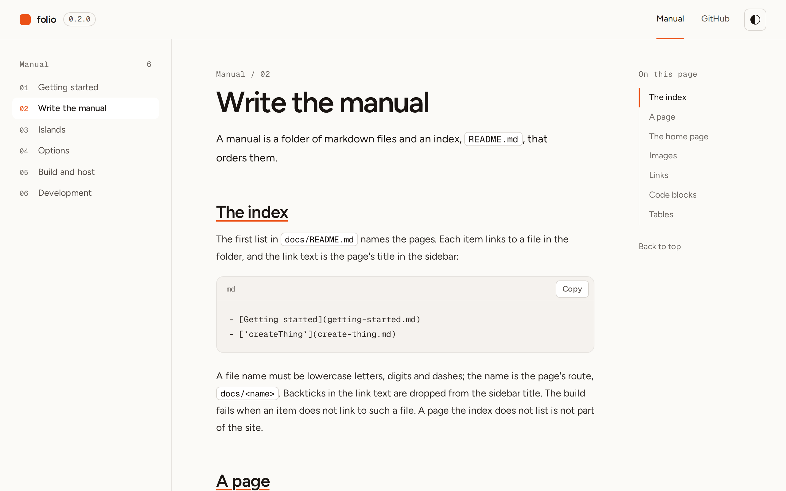

# folio

folio builds a documentation site from a repository's `docs/` folder. Each
manual page becomes static HTML, and a page can mount a Solid island for a live
demo. Its own manual is built with it:
[folio.rising.sh](https://folio.rising.sh).



## Install

```sh
bun add -d @risinghq/folio
```

## Example

```sh
bunx folio init     # docs/README.md, docs/index.md and the docs:* scripts
bun run docs:dev    # serve the site while editing
```

`docs/README.md` orders the pages in its first list:

```md
- [Getting started](getting-started.md)
```

The title, version and GitHub link come from `package.json`.

## Features

- One static HTML page per manual page, numbered in the index's order.
- A home page from `docs/index.md`, and images served from the docs folder.
- Solid islands placed with `<!-- island NAME -->`, mounted as they near the
  viewport.
- Shiki-highlighted code blocks with a copy button.
- A table of contents from each page's `##` and `###` headings.
- Links between `.md` pages become routes; other `.md` links open on GitHub.
- Light and dark themes; the choice persists across pages.
- A Vite plugin, `folio()`, for a project with its own Vite config.

## Links

- [Manual](https://folio.rising.sh/docs/getting-started)
- [Development and releases](docs/development.md)
