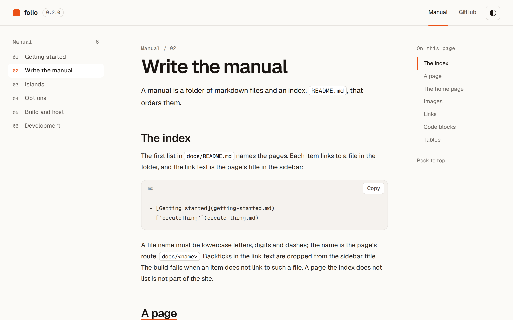

# A documentation site from your docs folder

folio turns a repository's `docs/` folder into a static site. Each markdown page
becomes HTML, and a page can mount a live Solid component where it needs a demo.

```sh
bun add -d https://github.com/risinghq/folio/releases/latest/download/folio.tgz
bunx folio init
bun run docs:dev
```

[Get started](getting-started.md) [GitHub](https://github.com/risinghq/folio)


